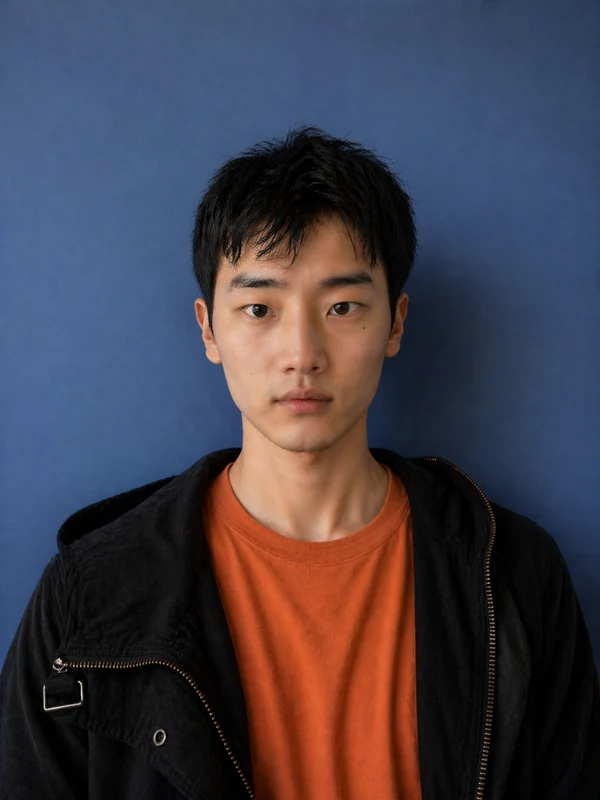
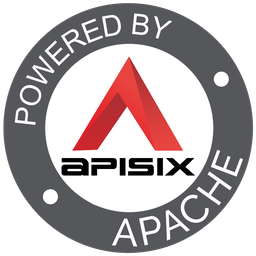
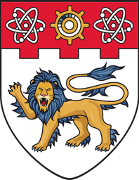
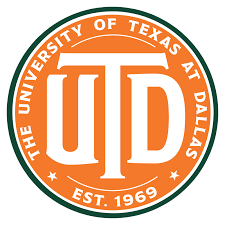
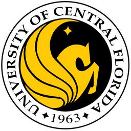
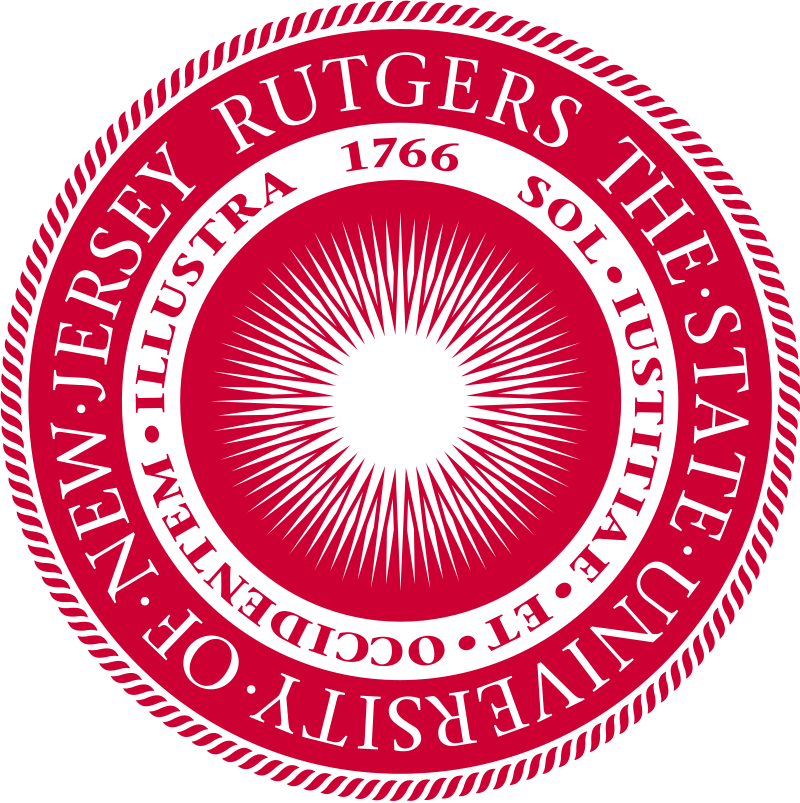
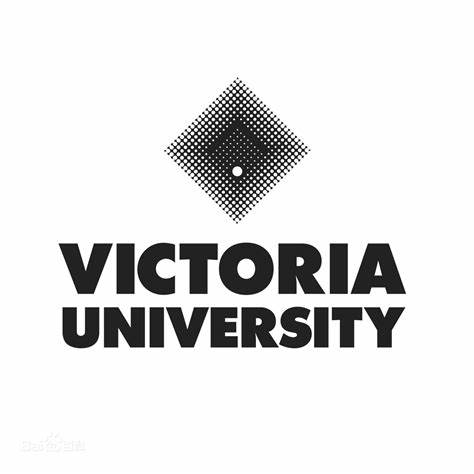
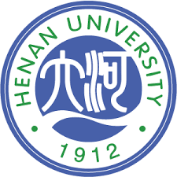

<!-- Teaser Section with Text Wall -->
<section id="teaser" class="teaser-section">
    

        
    

    

        

                Requirements for implementing an ideal world model: 1. Encode all information to the boundary. 2. Conform to conformal symmetry. Follow this rule, flattens the world into a two-dimensional space, and visual generation is almost lossless world generation.
                Definition of an ideal world model: 1. Spatial sequence 2. Time sequence 3. Dense representation 4. Semantic instances 5. World core 6. Physical constraint 7. RIVE, Reasonable, Interpretable, Visualizable, and Editable. 8. Bidirectional training and inference 9. All living animals have posture information.
                The method to make vision models understand physics is to create a core space and implement constraints within it.
                Ideal world models possess conformal symmetry, e.g., representing data positions as "relative positions", allowing the core space to have tremendous freedom and robustness. Eg, this can solve the fixed resolution problem in ViT and aligns with human intuition.
                Adding high-dimensional features/the complexity of the latent space manifold itself (using WSG), and reducing the actual distribution of the latent space (based on flow models or physically consistent data) all contribute to semantic consistency.
                The key to the wave-based model is using waves to record spatial information to create multi-perspective consistency, human id consistency and behavior consistency.
                The coordinates of a moving camera are one of the key pieces of information that help the model understand the world. Observing the world while moving is like querying a high-dimensional manifold, similar to how Earth is a sphere rather than a flat plane. Conventional generative models are equivalent to generating from a fixed perspective.
                The principle of least action is the underlying principle of the world and can explain all known physical systems. Therefore, as long as we conform to the principle of least action, we hold the key to making models understand physics.
                The breaking and merging of waves can represent a cup shattering or cars colliding, representing moments of sudden change in otherwise smoothly evolving systems. This is the final mile that visual models need to complete.
                WaveGen is a type of wave-based model that, just as waves on the surface are driven by ocean currents below, is based on flow models. The World Snapshot Model is an ideal world model implemented through WaveGen. ControlWave utilizes the data characteristics of the world model itself to control the world.
                All the pixels of our work exhibit wave-particle duality. In the field of world snapshots, waves represent reconstruction, time-space, order and existence, while particles represent generation, rendering, understanding and cognition.
                In Computer Vision before WSM be proposed, all estimation tasks can be regarded as deriving WSG from images, all conditional generation tasks can be seen as generating WSG with fixed partial results, and all reconstruction tasks can be considered as obtaining WSG sets through known images.
                The latent space of WaveGen has the characteristics of being Reasonable, Interpretable, Visualizable, and Editable. Unlike all the previous works: the parameter latent space of previous models only has the simplest I/O interface.
        

        <a href="https://world-snapshot.github.io/doc/index.html?page=S6_materials/02_guideline.md#tldr-of-project-page" class="text-wall-triangle" target="_blank">▼</a>
        

            Sen Fang
        

    

</section>

I'm **Sen Fang**, a third-year Ph.D. student at [Rutgers University](https://en.wikipedia.org/wiki/Rutgers_University), supervised by [Prof. Dimitris Metaxas](https://people.cs.rutgers.edu/~dnm/)<fn>Board of Governors and Distinguished Prof. Dimitris Metaxas; IEEE Fellow, Fellow AIMBE, Fellow MICCAI Society</fn>. I proposed [Unified Law for Visual Tasks](https://github.com/World-Snapshot/Unified-Law-for-Visual-Tasks) ("The Four Laws of Computer Vision"), and I am the author of [World Snapshot Model](https://world-snapshot.github.io). I was the first researcher in the history of computer vision to unify over thousands of visual tasks<fn>Before my work, a single unified computer vision method (excluding approaches that merely unified application scenarios) covered at most around 30 tasks. 99.99% of vision models are designed to handle single visual tasks, meaning that, until now, vision has not been unified by large language models as natural language processing has. I increased this tasks' number to more than 3,000, and the expansion is far from over.</fn>,  which my works have further advanced the progress of whole Computer Vision concepts. I am academically descended from [David Marr](https://en.wikipedia.org/wiki/David_Marr_(scientist))<fn>Widely regarded as the father of modern computer vision.</fn>.

Before this, I was nominated for the ACL 2026 Best Paper Award, I had an internship or collaboration at [Apache](https://github.com/apache), [NTU](https://www.ntu.edu.sg/), [NUS](https://www.nus.edu.sg/), [UTD](https://www.utdallas.edu/), [UCF](https://www.ucf.edu), [Hedra](https://www.hedra.com/) successively. I obtained a double CS B.S. degree in 2024, and received the Best Thesis Award.
My main research field is **Computer Vision** (3DV, Generative Method, Human Pose). Recently I have been interested in the following topics:
- <strong>World Snapshot</strong> - This is the research field I have pioneered (including full CV + the parts of NLP/Audio), which has expanded the boundaries of computer vision. The main focus/goal is on integrating thousands of generation/understanding/reconstruction/estimation CV tasks into a single model, just like how LLMs have contributed to NLP<fn>More specifically, computer vision should have an emperor-level model, similar to the status of LLM in NLP: We shall hope previous visual models have been completely replaced by WSMs, and it is hoped that WSMs should receive far more citations than LLMs. After all, the field of computer vision is much larger than NLP, and it has always been a top-level research area. However, it was a little late in giving birth to the next generation of models because images are more difficult to train than text.</fn>. It involves the definition of the model, training, and processing of new data formats. It is a long-term project dedicated to realizing the ideal world model.
- <strong>Sign Language</strong> - It involves many fields, such as the conversion between text/audio and movement/gestures, human body reconstruction and recognition, human pose synchronization, Pose-guided image generation, avatar reconstruction, and style transfer, etc. This topic has high technical requirements, and you must achieve a high level in all the above fields before it can be applied to sign language datasets.

I am open to academic/industrial collaborations, and please drop me an email if you are interested in collaborating with me (see my <a href="?page=04_blog.md#research-interests" class="nav-section-link" data-page="04_blog.md" data-section="research-interests">full interests</a>). I plan to apply for the Intern position related to World Snapshot at 27 Summer (Lasting for 3 months or 6 to 9 months, 6 to 9 months option is better.) and then enter the full-time job market at 2028 Jan.

<a href="https://github.com/fangsen9000/"><i class="fa-brands fa-github"></i></a><a href="https://scholar.google.com/citations?user=BJb9MsgAAAAJ&hl=en" aria-label="Google Scholar"><i class="fa-brands fa-google-scholar"></i></a><a href="https://huggingface.co/FangSen9000/activity/all" aria-label="Hugging Face"></a><a href="https://twitter.com/SenFang01"><i class="fa-brands fa-x-twitter"></i></a><fn>Paper Promotion</fn><a href="https://www.threads.com/@senfang01"><i class="fa-brands fa-threads"></i></a><fn>Academic Thinking</fn><a href="https://www.linkedin.com/in/fangsen/"><i class="fa-brands fa-linkedin"></i></a><fn>General Contact Information</fn><a href="https://www.xiaohongshu.com/user/profile/671ed236000000000d026aad"></a><a href="mailto:fangsen2024@gmail.com"><i class="fa-solid fa-envelope"></i></a>

*last updated: 2026-03-31*

## News

e.classList.remove('active'));this.classList.add('active');">Selected&#8204;e.classList.remove('active'));this.classList.add('active');">All

- **2026.4** One paper was accepted by <a href="https://icml.cc/Conferences/2026" class="venue-accent">ICML 2026</a>, Seoul, South Korea.
- **2026.4** One paper was accepted and nominated as the Best Paper Award by <a href="https://2026.aclweb.org/" class="venue-accent">ACL 2026 Main Conference</a>, San Diego, California, USA.
- **2025.3** According to the plan from a year ago, I will join [Hedra Inc.](https://www.hedra.com/) to research foundational video generation models.
- **2024.12** An amazing day. Maybe I was inspired by God, or maybe I found my lifelong career.
- **2024.6** I got the [Best Bachelor's Thesis](https://jwc.henu.edu.cn/info/2145/8713.htm) award of [Henan University](https://en.wikipedia.org/wiki/Henan_University).
- **2024.2** I have received the offer of dream advisor and will start my doctoral career.

- **2026.4** One paper was accepted by <a href="https://icml.cc/Conferences/2026" class="venue-accent">ICML 2026</a>, Seoul, South Korea.
- **2026.4** One paper was accepted and nominated as the Best Paper Award by <a href="https://2026.aclweb.org/" class="venue-accent">ACL 2026 Main Conference</a>, San Diego, California, USA.
- **2025.9** One app was accepted by <a href="https://iccv.thecvf.com/Conferences/2025/CallForDemos" class="venue-accent">ICCV 2025 Demo Track</a>, Honolulu, Hawaii, USA.
- **2025.7** One paper was accepted by <a href="https://cv4a11y.github.io/ICCV2025/index.html" class="venue-accent">ICCV 2025 CV4A11y</a>, Honolulu, Hawaii, USA.
- **2025.4** One paper was accepted by <a href="https://sites.google.com/view/fmllmgm-fg25" class="venue-accent">IEEE 2025 FG FM&LLM&GM</a>, Clearwater, Florida, USA.
- **2025.3** According to the plan from a year ago, I will join [Hedra Inc.](https://www.hedra.com/) to research foundational video generation models.
- **2024.12** An amazing day. Maybe I was inspired by God, or maybe I found my lifelong career.
- **2024.6** I got the [Best Bachelor's Thesis](https://jwc.henu.edu.cn/info/2145/8713.htm) award of [Henan University](https://en.wikipedia.org/wiki/Henan_University).
- **2024.2** I have received the offer of dream advisor and will start my doctoral career.
<!--
- **2023.10** An article was accepted by <a href="https://sigtyp.github.io/ws2023-mrl.html" class="venue-accent">EMNLP MRL</a>.
- **2023.9** As Intern of Prof [Chen Chen](https://www.crcv.ucf.edu/chenchen/) to explore the large language model of sign language. He is a professor from UCF(<a href="https://csrankings.org/#/index?vision&us" class="venue-accent">Top10 CV@CS-ranking</a>), with over ... citations.
- **2023.8** One of my articles was accepted by <a href="http://www.iconip2023.org/" class="venue-accent">ICONIP</a>, the flagship conference of <a href="https://www.apnns.org/" class="venue-accent">APNNS</a>!
- **2023.2** Started sign language production work under the guidance of Prof [Yapeng Tian](http://www.yapengtian.com/) from UTD, SPC/AC of Top-level conferences, such as <a href="https://cvpr.thecvf.com/" class="venue-accent">CVPR</a>/<a href="https://aaai-23.aaai.org/" class="venue-accent">AAAI</a>, with over ... citations.
- **2022.7** As a study researcher of Prof [TeikToe Teoh](https://github.com/teohteiktoe), joined NTU in Summer research.
- **2022.6** As a student of mentor [SkyeYoung](https://github.com/SkyeYoung), joined APISIX in <a href="https://summer-ospp.ac.cn/" class="venue-accent">OSPP 2022</a>, who is an Apache member of the top project with .
- **2022.2** Completed 2 months of Bytedance youth-camp as a team captain.
- **2021.9** Completed 2 months of ACM training.
-->

## Selected Works

<link rel="stylesheet" href="static/css/pub.css">

  <button class="pub-legend-close" type="button" aria-label="Hide publication symbols" title="Hide" onclick="this.parentElement.hidden = true">×</button>
  

Loading publications…

→ [Google Scholar](https://scholar.google.com/citations?hl=en&user=BJb9MsgAAAAJ)

## Experience

e.classList.remove('active'));document.getElementById('exp-work').classList.add('active');this.parentElement.querySelectorAll('.tab').forEach(e=>e.classList.remove('active'));this.classList.add('active');">Work Experience&#8204;e.classList.remove('active'));document.getElementById('exp-edu').classList.add('active');this.parentElement.querySelectorAll('.tab').forEach(e=>e.classList.remove('active'));this.classList.add('active');">Education&#8204;e.classList.remove('active'));document.getElementById('exp-lineage').classList.add('active');this.parentElement.querySelectorAll('.tab').forEach(e=>e.classList.remove('active'));this.classList.add('active');">Academic Lineage

<!--
<table class="imgtable"><tbody><tr><td>
  </td>
  <td align="left">
<b>Microsoft Research  </b>  
  Motion Generation Intern, 3DV, Multi-Modal
   
  <i>Summer, 2025 (Expected) -- Winter, 2025</i>  
  
</td></tr></tbody></table>
 
-->
<table class="imgtable"><tbody><tr><td>
  </td>
  <td align="left">
<b>Hedra Inc.  </b>  
  Research Intern: GenAI, Talking-Face 
   
  Mentor: <a href="https://scholar.google.com/citations?user=ocMf7fQAAAAJ">DR. Hongwei Yi</a>
   
  <i>May, 2025 -- July, 2025</i>  
  
</td></tr></tbody></table>
 

<table class="imgtable"><tbody><tr><td>
  </td>
  <td align="left">
<b>University of Central Florida  </b>  
  Research Assistant: 3DV-LLM, Multi-Modal
   
  Advisor: <a href="https://www.crcv.ucf.edu/chenchen/">Prof. Chen Chen</a>
   
  <i>Sep, 2023 -- Aug, 2024</i>  
  
</td></tr></tbody></table>
 
<table class="imgtable"><tbody><tr><td>
  </td>
  <td align="left">
<b>University of Texas at Dallas  </b>  
  Research Assistant: Vid2Vid, Multi-Modal
   
  Advisor: <a href="http://www.yapengtian.com/">Prof. Yapeng Tian</a>
   
  <i>Feb, 2023 -- Dec, 2023</i>  
  
</td></tr></tbody></table>
 
<table class="imgtable"><tbody><tr><td>
  </td>
  <td align="left">
<b>Nanyang Technological University  </b>  
  Student Intern: Speech DL, Multi-Modal
   
  Advisor: <a href="https://github.com/teohteiktoe">Prof. TeikToe Teoh</a>
   
  <i>Jul, 2022 -- Dec, 2022</i>  
  
</td></tr></tbody></table>
 
<table class="imgtable"><tbody><tr><td>
  </td>
  <td align="left">
<b>Apache Software Foundaiton  </b>  
  Developer Intern: <a href="https://github.com/apache/apisix">APISIX</a>/<a href="https://api7.ai/">api7.ai</a>, <a href="https://news.apache.org/foundation/entry/the-apache-software-foundation-announces66">Top Level Project</a>
   
  Mentor: <a href="https://github.com/SkyeYoung">Tao Yang</a>
   
  <i>Jun, 2022 -- Nov, 2022</i>  
  
</td></tr></tbody></table>

<table class="imgtable"><tbody><tr><td>
  </td>
  <td align="left">
<b>Rutgers University–New Brunswick  </b>
  Ph.D., Department of Computer Science
  Advisor: Board of Governors and Distinguished Professor
  IEEE Fellow, Fellow AIMBE, Fellow MICCAI Society
  <a href="https://people.cs.rutgers.edu/~dnm/">Prof. Dimitris N. Metaxas</a> and <a href="?page=static/CBIM-Lab/people.md">CBIM</a>
  New Jersey (USA)
  <i>Sep, 2024 -- June, 2029 (Expected)</i>
  
</td></tr></tbody></table>
 
<table class="imgtable"><tbody><tr><td>
  </td>
  <td align="left">
<b>Victoria University  </b>
  B.S., Department of Information Technology
  Melbourne (Australia)
  <i>Sep, 2020 -- Jun, 2024</i>
  
</td></tr></tbody></table>
 
<table class="imgtable"><tbody><tr><td>
  </td>
  <td align="left">
<b>Henan University  </b>
  B.S., Department of Computer Science and Technology
  Zhengzhou (China)
  <i>Sep, 2020 -- Jun, 2024</i>
  
</td></tr></tbody></table>

As the largest field of AI, computer vision has the world's largest community of AI practitioners and exerts a profound influence on modern society. Since David Marr defined modern computer vision, a large part of the field has been extended, passed down, and expanded from generation to generation, especially by his doctoral students. For details, see the <a href="https://en.wikipedia.org/wiki/Computer_vision#History" target="_blank">history of computer vision on Wikipedia</a>. The academic forebears of our lab played a substantial role in this process, and not only after works such as CNNs, GANs, and AlexNet emerged in the 2010s.

- <a href="https://en.wikipedia.org/wiki/David_Marr_(scientist)" target="_blank"><b>David Marr</b></a> (1945–1980) 
Ph.D. in Physiology, <a href="https://en.wikipedia.org/wiki/Trinity_College,_Cambridge" target="_blank">Trinity College, Cambridge</a>; Faculty at <a href="https://en.wikipedia.org/wiki/MIT" target="_blank">MIT</a>
Founder of computational vision; pioneered the three-level framework (computational, algorithmic, implementational) for understanding vision
IJCAI Computers and Thought Award; the International Conference on Computer Vision (ICCV) Best Paper Award (Marr Prize) is named in his honor
Referred to by most records as the <b>Father of Computational Vision</b><fn>Some historical accounts refer to Larry Roberts as the father of computer vision, but credit him primarily with initiating early machine vision through the geometric interpretation of edges, lines, and 3D structures. After his PhD work, he later transitioned away from vision research and became a pioneer of networking and ARPANET research. In contrast, David Marr introduced foundational concepts such as hierarchical visual representations, internal representations, information transformation, the primal sketch, the 2.5D sketch, and 3D model representations — terminology and ideas that continue to influence modern computer vision and embodied intelligence today. His lasting intellectual influence is reflected in ICCV’s David Marr Prize — the only best paper award across major computer vision conferences named after an individual researcher.
</fn>
Lab: Shimon Ullman (first PhD student); Eric Grimson (was MIT president); John M. Hollerbach (CIFAR, IEEE Fellow).

- <a href="https://en.wikipedia.org/wiki/Shimon_Ullman" target="_blank"><b>Shimon Ullman</b></a> 
Ph.D., <a href="https://en.wikipedia.org/wiki/MIT" target="_blank">MIT</a> (1977), advised by David Marr; Professor, <a href="https://en.wikipedia.org/wiki/Weizmann_Institute_of_Science" target="_blank">Weizmann Institute of Science</a>; former Professor, <a href="https://en.wikipedia.org/wiki/MIT" target="_blank">MIT</a>
Visual object/face recognition, visual saliency, computational models of biological vision
Member, American Academy of Arts and Sciences; Member, Israeli Academy of Sciences and Humanities; Fellow, Cognitive Science Society; Israel Prize in Computer Science (2015); David E. Rumelhart Prize (2008); Azriel Rosenfeld Lifetime Achievement Award (2019); One of the early founders of ICCV<fn>General Chair of 2th-ICCV 1988 and CVPR 2026 (honorable).</fn>
Lab: <a href="https://www.weizmann.ac.il/math/shimon/home" target="_blank">Ullman Lab, Weizmann Institute of Science</a>; Graduated 33+ Ph.D. and 51+ M.S. students

- <a href="https://en.wikipedia.org/wiki/Demetri_Terzopoulos" target="_blank"><b>Demetri Terzopoulos</b></a> 
Ph.D. in AI, <a href="https://en.wikipedia.org/wiki/MIT" target="_blank">MIT</a> (1984), advised by Shimon Ullman; Distinguished & Chancellor's Professor, <a href="https://en.wikipedia.org/wiki/University_of_California,_Los_Angeles" target="_blank">UCLA</a>; former Professor, <a href="https://en.wikipedia.org/wiki/University_of_Toronto" target="_blank">University of Toronto</a> & <a href="https://en.wikipedia.org/wiki/New_York_University" target="_blank">NYU</a>
Computer graphics, computer vision, deformable models, active contours (snakes), medical imaging, artificial life
Fellow of the Royal Society (FRS); Fellow of the Royal Society of Canada (FRSC); IEEE Fellow; ACM Fellow; Academy Award for Technical Achievement (2006); IEEE Computer Pioneer Award (2020); Helmholtz Prize (ICCV Test of Time Award, 2013); Inaugural Marr Prize (ICCV Best Paper Award, 1987)
Lab: <a href="http://gravilab.cs.ucla.edu/" target="_blank">UCLA Computer Graphics & Vision Group</a>; Graduated 50+ Ph.D. and 130+ M.S. students; advised 200+ students and postdoctoral scholars in total

- <a href="https://en.wikipedia.org/wiki/Dimitris_Metaxas" target="_blank"><b>Dimitris N. Metaxas</b></a> 
Ph.D., <a href="https://en.wikipedia.org/wiki/University_of_Toronto" target="_blank">Toronto</a> (1992), advised by Demetri Terzopoulos; Board of Governors and Distinguished Professor, <a href="https://en.wikipedia.org/wiki/Rutgers_University" target="_blank">Rutgers</a>; former Professor, <a href="https://en.wikipedia.org/wiki/University_of_Pennsylvania" target="_blank">Pennsylvania</a>
Computer vision, biomedical image analysis, medical image computing, deformable models
IEEE Fellow; Fellow AIMBE; Fellow MICCAI Society; General Chair<fn>among only five individuals to have served four or more times as General Chair in the ~40-year, ~100-person history of CVPR/ICCV</fn> of CVPR 2014, 2026 & ICCV 2011, 2031 & MICCAI 2008; Long-standing member of the <a href="https://www.thecvf.com/docs/CVPR%20ICCV%20bylaws%20final.pdf" target="_blank">CVPR/ICCV Steering Committee</a> and <a href="https://tc.computer.org/tcpami/" target="_blank">TC PAMI (IEEE Computer Society Technical Committee on Pattern Analysis and Machine Intelligence)</a><fn>TC PAMI (IEEE Computer Society Technical Committee on Pattern Analysis and Machine Intelligence) is the highest governing body in the field of computer vision. It jointly hosts the three flagship conferences CVPR, ICCV, and WACV with CVF. It oversees all six career awards and three classic paper awards, and provides technical sponsorship for international conferences such as FG, ICPR, and ACII. This essentially covers the entire system from academic evaluation to talent recognition in computer vision.</fn>
Lab: <a href="?page=static/CBIM-Lab/people.md">CBIM, Rutgers University</a>; Graduated 80+ Ph.D. students (1/3 are professors worldwide)

- **Sen Fang** 
Ph.D. student, <a href="https://en.wikipedia.org/wiki/Rutgers_University" target="_blank">Rutgers University</a>, advised by Prof. Dimitris N. Metaxas
Computer Vision, World Snapshot Model, Sign Language
Computer Vision’s Unifier After the Field’s Half-Century Expansion
ACL 2026 Best Paper Award Nominee

## Talks

- **Conversations on the Present and Future of Sign Language Generation (2024–2026)**
  - **Summary:** Discussions with Amazon, Swiss Television, Waterloo, Dicpta Inc., and Mo-Sys Inc. on the current state, limitations, and future directions of sign language generation.
  - **Media Coverage:** [New Scientist](https://www.newscientist.com/) (5+ million readers)
  - **Public Reach (as of September 2024):** SignLLM received unsolicited coverage from more than 80 media outlets and independent content creators, reaching over 10 million views.
  - [Search for "SignLLM"](https://www.bing.com/search?q=SignLLM) with Microsoft Bing
  - [Search for "SignLLM"](https://www.google.com/search?q=SignLLM) with Google
  - [Talk about "SignLLM"](https://chatgpt.com/) with ChatGPT
- **Make an Appointment:** The quickest way to reach me is by email or through X, GitHub, or LinkedIn. We can then arrange a Google Calendar event.

*This record includes invitations I was unable to accept because of scheduling constraints.*

## Service

- **Program Committee Member:**
  - IEEE International Conference on Automatic Face and Gesture Recognition (IEEE FG 2026)
  - International Conference on Neural Information Processing (ICONIP 2024, 2026)
  - First International Workshop on Foundation, Multimodal Large Language and Generative Models for Face and Gesture Recognition (FM&LLM&GM 2025)
  - First International Workshop on Empathic AI: Face, Gesture, and Accessibility Technologies (EmpAI 2026)
- **Conference Reviewer:**
  - Conference on Neural Information Processing Systems (NeurIPS 2024, 2026)
  - International Conference on Machine Learning (ICML 2024)
  - International Conference on Learning Representations (ICLR 2025, 2027)
  - IEEE/CVF International Conference on Computer Vision (ICCV 2025)
  - IEEE/CVF Winter Conference on Applications of Computer Vision (WACV 2026)
  - ACM International Conference on Multimedia (ACM MM 2025–2026)
  - IEEE International Conference on Automatic Face and Gesture Recognition (IEEE FG 2025)
  - International Conference on Neural Information Processing (ICONIP 2023–2024)
  - Conference on Empirical Methods in Natural Language Processing (EMNLP 2023)
  - Annual Conference of the North American Chapter of the Association for Computational Linguistics (NAACL 2024)
  - ACL Rolling Review (ARR 2023–2024)

## Teaching

- **Fall 2026:** [01-198-334: Introduction to Imaging and Multimedia](https://www.cs.rutgers.edu/academics/undergraduate/course-synopses/course-details/01-198-334-introduction-to-imaging-and-multimedia)
- **Spring 2026:** [01-198-323: Numerical Analysis and Computing](https://www.cs.rutgers.edu/academics/undergraduate/course-synopses/course-details/01-198-323-numerical-analysis-and-computing)
- **Fall 2025:** [01-198-336: Principles of Information and Data Management](https://www.cs.rutgers.edu/academics/undergraduate/course-synopses/course-details/01-198-336-principles-of-information-and-data-management)
- **Spring 2025:** [01-198-210: Data Management for Data Science](https://www.cs.rutgers.edu/academics/undergraduate/course-synopses/course-details/01-198-210-data-management-for-data-science)
- **Fall 2024:** [01-198-352: Internet Technology](https://www.cs.rutgers.edu/academics/undergraduate/course-synopses/course-details/01-198-352-internet-technology)

## Awards

- <strong>ACL 2026 Best Paper Award Nominee:</strong> Out of 12,148 submissions. This is a highly competitive nomination for the award -- Over the recorded period from **2001 to 2025 whole world**, there were **76 ACL Best Papers**, and 21 of them had Chinese descent as the first author. ACL is the **1st-ranking** publication in the field of Natural Language Processing (NLP).
- <strong>Henan Provincial Best Thesis Award Nominee</strong> (home to ~100 million people)
- <strong>Best Thesis Award</strong> in Henan University (out of 8,560 graduates) [[News]](https://jwc.henu.edu.cn/info/2145/8713.htm)  
- **National Encouragement Scholarship<fn>Undergraduate Student during Henan University</fn>:** 2020-2021, 2023-2024

## Other

Part of My Friends (alphabetical by institution)

- Georgia Tech/Together AI: [Hongbin Zhong](https://rjzhb.github.io/)
- NTU: [Yalin Feng](https://yalin-feng.github.io)
- UW-Madison/NVIDIA: [Yanxin Zhang](https://github.com/yanxinzhangcs)
- Rutgers: [List of My Labmates](?page=static/CBIM-Lab/people.md); Levi Che
- Tsinghua/HKUST: Jiayin Zhu
- Waterloo: Yifan Wang
- I have guided some undergraduate students in lower grades than mine. I can't recall exactly how many there were, but it was more than 5 but less than 15.
<!-- [Chunyu Sui (林奈)](https://github.com/capsfly), [Baiang Li (ztmotalee)](https://ztmotalee.github.io/), [Yangyang Wu (考拉)](https://www.linkedin.com/in/yangyang-wu-2759181b3/) -->

 

  

    0 Pageviews
    Loading visitor history…
  

  

    

      <canvas class="visitor-map-canvas" data-visitor-canvas role="img" aria-label="Map of website visitors"></canvas>
    

    

      <button type="button" data-visitor-zoom="in" aria-label="Zoom in">+</button>
      <button type="button" data-visitor-zoom="out" aria-label="Zoom out">−</button>
    

  

  

  

    
Visitor locations

    

  

