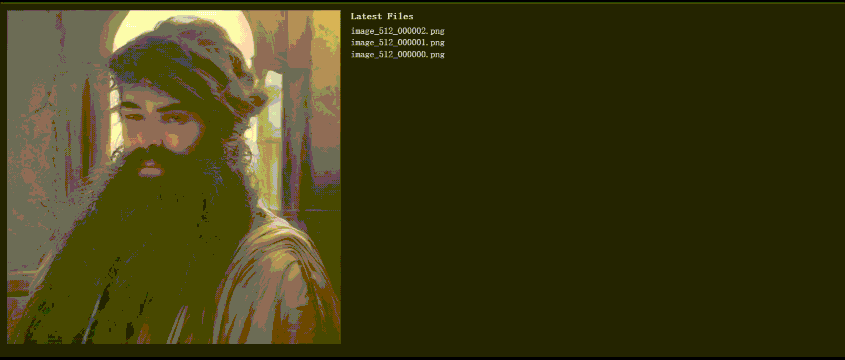

<!-- Teaser Section with Text Wall -->
<section id="teaser" class="teaser-section">
    

        
    

    

        

                Requirements for implementing an ideal world model: 1. Encode all information to the boundary. 2. Conform to conformal symmetry. Follow this rule, flattens the world into a two-dimensional space, and visual generation is almost lossless world generation.
                Definition of an ideal world model: 1. Spatial sequence 2. Time sequence 3. Dense representation 4. Semantic instances 5. World core 6. Physical constraint 7. RIVE, Reasonable, Interpretable, Visualizable, and Editable. 8. Bidirectional training and inference 9. All living animals have posture information.
                The method to make vision models understand physics is to create a core space and implement constraints within it.
                Ideal world models possess conformal symmetry, e.g., representing data positions as "relative positions", allowing the core space to have tremendous freedom and robustness. Eg, this can solve the fixed resolution problem in ViT and aligns with human intuition.
                Adding high-dimensional features/the complexity of the latent space manifold itself (using WSG), and reducing the actual distribution of the latent space (based on flow models or physically consistent data) all contribute to semantic consistency.
                The key to the wave-based model is using waves to record spatial information to create multi-perspective consistency, human id consistency and behavior consistency.
                The coordinates of a moving camera are one of the key pieces of information that help the model understand the world. Observing the world while moving is like querying a high-dimensional manifold, similar to how Earth is a sphere rather than a flat plane. Conventional generative models are equivalent to generating from a fixed perspective.
                The principle of least action is the underlying principle of the world and can explain all known physical systems. Therefore, as long as we conform to the principle of least action, we hold the key to making models understand physics.
                The breaking and merging of waves can represent a cup shattering or cars colliding, representing moments of sudden change in otherwise smoothly evolving systems. This is the final mile that visual models need to complete.
                WaveGen is a type of wave-based model that, just as waves on the surface are driven by ocean currents below, is based on flow models. The World Snapshot Model is an ideal world model implemented through WaveGen. ControlWave utilizes the data characteristics of the world model itself to control the world.
                All the pixels of our work exhibit wave-particle duality. In the field of world snapshots, waves represent reconstruction, time-space, order and existence, while particles represent generation, rendering, understanding and cognition.
                In Computer Vision before WSM be proposed, all estimation tasks can be regarded as deriving WSG from images, all conditional generation tasks can be seen as generating WSG with fixed partial results, and all reconstruction tasks can be considered as obtaining WSG sets through known images.
                The latent space of WaveGen has the characteristics of being Reasonable, Interpretable, Visualizable, and Editable. Unlike all the previous works: the parameter latent space of previous models only has the simplest I/O interface.
        

        <a href="https://world-snapshot.github.io/doc/index.html?page=S6_materials/02_guideline.md#tldr-of-project-page" class="text-wall-triangle" target="_blank">▼</a>
        

            Sen Fang
        

    

</section>

I'm **Sen Fang**, a second-year Ph.D. student at [Rutgers University](https://en.wikipedia.org/wiki/Rutgers_University), supervised by [Prof. Dimitris Metaxas](https://people.cs.rutgers.edu/~dnm/). I proposed [Unified Law for Visual Tasks](https://github.com/World-Snapshot/Unified-Law-for-Visual-Tasks) (The Four Laws of Computer Vision), and I am the author of [World Snapshot Model](https://world-snapshot.github.io), which have further advanced the progress of Machine Learning, mainly in terms of computer vision concepts. Before this, I had an internship or collaboration at [Apache](https://github.com/apache), [NTU](https://www.ntu.edu.sg/), [NUS](https://www.nus.edu.sg/), [UTD](https://www.utdallas.edu/), [UCF](https://www.ucf.edu), [Hedra](https://www.hedra.com/) successively. I obtained a double CS B.S. degree in 2024.

My main research field is **Computer Vision**. My research interest covers **Multimodal** ([100+% multimodal fusion](https://github.com/World-Snapshot/100-percent-multimodal-fusion)1, Audio-Visual, Study the Essence of different Modal Representations), **AIGC** (AI-generated content, Multi-view learning, NeRF/3D), **Self-Supervised** Learning (Pose recognition and modeling, object & action detection/recognition in videos, Image Analysis) and **VR/AR/DCG** and **Visual Perception** (Modeling Digital Reality, including human and dynamic scene).

Recently I have been interested in the following topics:
- <strong>World Snapshot</strong> - This is the research field I have pioneered (including full CV + the parts of NLP/Audio), which has expanded the boundaries of computer vision. The main focus/goal is on integrating thousands of generation/understanding/reconstruction/estimation CV tasks into a single model, just like how LLMs have contributed to NLP2. It involves the definition of the model, training, and processing of new data formats. It is a long-term project dedicated to realizing the ideal world model.
<!--
- <strong>Wave Generative Method</strong> - The conceptual new generation mechanism I have designed3. It aims to use mathematical functions to losslessly record dynamic 3D shapes, fundamentally reducing the generated string/values while maintaining the same expression ability. It is dedicated to achieving some new features that was not well accomplished by previous methods4: like variable FPS, variable resolution, causality, physics, consistency, training the world itself, predicting the future/past, synchronizing the real world with model's core space, and pixel-level control of the world distribution, etc. With unlimited duration, native 3D+t has already seen many other solutions, so it is not worth mentioning.
-->
- <strong>Sign Language</strong> - It involves many fields, such as the conversion between text/audio and movement/gestures, human body reconstruction and recognition, human pose synchronization, Pose-guided image generation, avatar reconstruction, and style transfer, etc. This topic has high technical requirements, and you must achieve a high level in all the above fields before it can be applied to sign language datasets.

I am open to academic/industrial collaborations, and please drop me an email if you are interested in collaborating with me. I plan to apply for the Intern position related to WSMs and WaveGen at 26 Summer.

[Github](https://github.com/fangsen9000/) | [X/Twitter](https://twitter.com/SenFang01)o | [Threads](https://www.threads.com/@senfang01)o | [LinkedIn](https://www.linkedin.com/in/fangsen/)o | Email: fangsen2024 [at] gmail [dot] com

*last updated: 2026-01-16*

## News

I no longer engage in purely NLP research without visual elements. The emperor model in the computer vision field has already been developed. Computer Vision Researchers have their own more important / stronger research.

SelectedAll

- **2025.3** According to the plan from a year ago, I will join [Hedra Inc.](https://www.hedra.com/) to research foundational video generation models.
- **2024.12** An amazing day. Maybe I was inspired by God, or maybe I found my lifelong career.
- **2024.6** I got the [Best Bachelor's Thesis](https://jwc.henu.edu.cn/info/2145/8713.htm) award of [Henan University](https://en.wikipedia.org/wiki/Henan_University).
- **2024.2** I have received the offer of dream advisor and will start my doctoral career.

- **2025.9** One app was accepted by [ICCV Demo Track](https://iccv.thecvf.com/Conferences/2025/CallForDemos).
- **2025.7** One paper was accepted by [ICCV CV4A11y](https://cv4a11y.github.io/ICCV2025/index.html).
- **2025.4** One paper was accepted by [IEEE FG FM&LLM&GM](https://sites.google.com/view/fmllmgm-fg25).
- **2025.3** According to the plan from a year ago, I will join [Hedra Inc.](https://www.hedra.com/) to research foundational video generation models.
- **2024.12** An amazing day. Maybe I was inspired by God, or maybe I found my lifelong career.
- **2024.6** I got the [Best Bachelor's Thesis](https://jwc.henu.edu.cn/info/2145/8713.htm) award of [Henan University](https://en.wikipedia.org/wiki/Henan_University).
- **2024.2** I have received the offer of dream advisor and will start my doctoral career.
- **2023.10** An article was accepted by [EMNLP MRL](https://sigtyp.github.io/ws2023-mrl.html).
- **2023.9** As Intern of Prof [Chen Chen](https://www.crcv.ucf.edu/chenchen/) to explore the large language model of sign language. He is a professor from UCF([Top10 CV@CS-ranking](https://csrankings.org/#/index?vision&us)), the top 2% of scientists in the world.
- **2023.8** One of my articles was accepted by [ICONIP](http://www.iconip2023.org/), the flagship conference of [APNNS](https://www.apnns.org/)!
- **2023.2** Started sign language production work under the guidance of Prof [Yapeng Tian](http://www.yapengtian.com/) from UTD, SPC/AC of Top-level conferences, such as [CVPR](https://cvpr.thecvf.com/)/[AAAI](https://aaai-23.aaai.org/), the author of [*'Residual Dense Network for Image Super-Resolution'*](https://openaccess.thecvf.com/content_cvpr_2018/html/Zhang_Residual_Dense_Network_CVPR_2018_paper.html), the top 2% of scientists in the world.
- **2022.7** As a study researcher of Prof [TeikToe Teoh](https://github.com/teohteiktoe), joined NTU in Summer research.
- **2022.6** As a student of mentor [SkyeYoung](https://github.com/SkyeYoung), joined APISIX in [OSPP 2022](https://summer-ospp.ac.cn/), who is an Apache member of the top project with over 10,000 stars.
- **2022.2** Completed 2 months of Bytedance youth-camp as a team captain.
- **2021.9** Completed 2 months of ACM training.

## Selected Works

*\* Equivalent contribution, † Corresponding author*

<link rel="stylesheet" href="static/css/pub.css">

**WSM: World Snapshot Model**   
**Sen Fang**, Dimitris N. Metaxas†  
[[Paper]](https://arxiv.org/abs/2511.22009) [[Project Page]](https://world-snapshot.github.io/StreamFlow/) [[Code]](https://github.com/World-Snapshot) [[Document]]()   
**Order-of-magnitude width + concept breakthrough:** Propose [WSM](https://github.com/World-Snapshot/StreamFlow) and [Unified Law for Visual Tasks](https://github.com/World-Snapshot/Unified-Law-for-Visual-Tasks) (The Four Laws of Computer Vision), which supports hundreds of times more tasks than existing models, thousands of times more tasks than theoretical support, and potentially 10k of times more tasks than existing CV methods.
<!-- Introduce a new generative model called [WaveGen](), which conceptually/advancedly extends the existing models by three times.-->

**SignX: Continuous Sign Recognition in Compact Pose-Rich Latent Space**   
**Sen Fang**, Yalin Feng*, Chunyu Sui, Hongbin Zhong, Hongwei Yi, Dimitris N. Metaxas†  
[[Paper]](https://arxiv.org/abs/2504.16315) [[Project Page]](https://signerx.github.io/SignX/)  
**Performance breakthrough:**  2026 CSLR SOTA. The recognition and understanding tasks on any sign language dataset can/will achieve state-of-the-art results.

**StreamFlow: Theory, Algorithm, and Implementation for High-Efficiency Rectified Flow Generation**   
**Sen Fang**, Hongbin Zhong*, Yalin Feng, Dimitris N. Metaxas†  
[[Paper]](https://arxiv.org/abs/2511.22009) [[Project Page]](https://world-snapshot.github.io/StreamFlow/) [[Code]](https://github.com/World-Snapshot/StreamFlow)  
**Order-of-magnitude performance breakthrough:** The generation speed of Rectified Flow has been accelerated by 600%, while the universal training-free Flow acceleration methods during the same period only increased by 18% or 30%.

**Stable Signer: Hierarchical Sign Language Generative Model**   
**Sen Fang**, Yalin Feng*, Hongbin Zhong, Yanxin Zhang, Dimitris N. Metaxas†  
*ICCV Demo Track*  
[[Paper]](https://arxiv.org/abs/2512.04048) [[Project Page]](https://stablesigner.github.io/) [[Data]](https://github.com/SignLLM/Prompt2Sign/tree/main/tools-new-2025)  
**Significant performance breakthrough:** Outperforms contemporary state-of-the-art generation methods by 48.6%.

**SignLLM: Sign Language Production Large Language Models**  
**Sen Fang**, Chen Chen†, Lei Wang, Ce Zheng, Chunyu Sui, Yapeng Tian  
*ICCVW 2025*  
[[Paper]](https://arxiv.org/abs/2405.10718) [[Project Website]](https://signllm.github.io/) [[Prompt2Sign Dataset]](https://signllm.github.io/Prompt2Sign)    
**Order-of-magnitude width breakthrough:** The single model supports the generation of 8 types of sign languages, and the number of SLP tasks it supports has increased by eight times.

<!--

**SignDiff: Diffusion Models for American Sign Language Production**  
**Sen Fang**, Chunyu Sui\*, Yanghao Zhou, Xuedong Zhang, Hongbin Zhong, Yapeng Tian†, Chen Chen†  
*IEEE FG 2025 Workshop*  
[[Paper]](https://arxiv.org/abs/2308.16082) [[Project Page]](https://signdiff.github.io) [[Preprocessed Data]](https://github.com/SignDiff/Processed-Data)

-->

→ [Google Scholar](https://scholar.google.com/citations?hl=en&user=BJb9MsgAAAAJ)

## Talks

- **Make an Appointment:** The quickest way to find me is to send me an email or remind me on X/Github/LinkedIn. Then we create a Google Calendar event.
- **Summary:** Amazon, Swiss Television, New Scientist, Waterloo, Dicpta Inc, Mo-Sys Inc.

*Including invitations I couldn't accept due to my busy schedule.*

 

