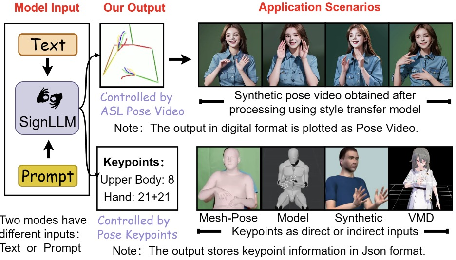
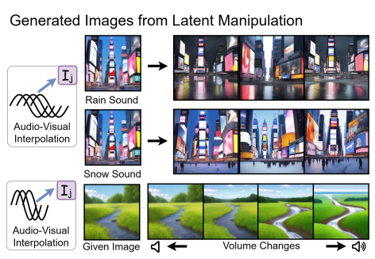
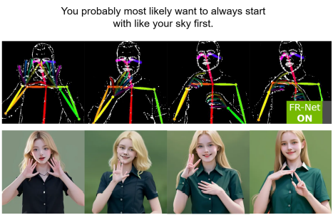

I'm **Sen Fang**, a second-year Ph.D. student at [Rutgers University](https://en.wikipedia.org/wiki/Rutgers_University), supervised by [Prof. Dimitris Metaxas](https://people.cs.rutgers.edu/~dnm/). Recently, I have been renowned for proposing [World Snapshot Model](https://world-snapshot.github.io) and [Wave Generative Method](https://github.com/World-Snapshot/WaveGen), which have further advanced the progress of Machine Learning, mainly in terms of computer vision concepts. Before this, I had an internship or collaboration at [Apache](https://github.com/apache), [NTU](https://www.ntu.edu.sg/), [NUS](https://www.nus.edu.sg/), [UTD](https://www.utdallas.edu/), [UCF](https://www.ucf.edu), [Hedra](https://www.hedra.com/) successively. I obtained a double CS B.S. degree in 2024.

My main research field is **Computer Vison**. My research interest covers **Multimodal** (Audio-Visual, talking-face and representation of text/audio, Audio Generated Image), **AIGC** (AI-generated content, Multi-view learning, NeRF/3D), **Self-Supervised** Learning (Pose recognition and modeling, object & action detection/recognition in videos, Human Image Analysis) and **VR/AR/DCG** and **Visual Perception** (Enables the agent to make plan and navigate)!

<!--

In the past, I was interested in the following topics:

- <strong>LLM/HCI/Embodied Intelligence</strong> - I will bring agents that can interact with scenes or people to reality, whatever it takes.
- <strong>Identify and Model Behavior</strong> - particularly in perceiving and synthesizing dynamic humans, objects, and scenes. I think controlling robots by self-supervised training through real-world data and Computer Vision related technologies is the right path.
- <strong>Sign Language</strong> - It involves many fields, such as the conversion between text/audio and movement/gestures, human body reconstruction and recognition, human pose synchronization, Pose-guided image generation, avatar reconstruction, and style transfer, etc. This topic has high technical requirements, and you must achieve a high level in all the above fields before it can be applied to sign language datasets.

-->

Recently I have been interested in the following topics:
- <strong>World Snapshot</strong> - This is the research field I have pioneered (including full CV + the parts of NLP/Audio), which has expanded the boundaries of computer vision. The main focus/goal is on integrating thousands of generation/understanding/reconstruction/estimation CV tasks into a single model, just like how LLMs have contributed to NLP. It involves the definition of the model, training, and processing of new data formats. It is a long-term project dedicated to realizing the ideal world model.
- <strong>Wave Generative Method</strong> - This is a conceptual project, an improvement on the existing generation method. It aims to use mathematical functions to losslessly record dynamic 3D shapes, fundamentally reducing the generated string/values while maintaining the same expression ability. It is dedicated to achieving variable FPS, variable resolution, causality, physics, consistency, training the world itself, and pixel-level control of the world distribution, etc.
- <strong>Sign Language</strong> - It involves many fields, such as the conversion between text/audio and movement/gestures, human body reconstruction and recognition, human pose synchronization, Pose-guided image generation, avatar reconstruction, and style transfer, etc. This topic has high technical requirements, and you must achieve a high level in all the above fields before it can be applied to sign language datasets.

I am open to academic/industrial collaborations, and please drop me an email if you are interested in collaborating with me. I plan to apply for the Intern position related to WSMs and WaveGen at 26 Summer.

[Google Scholar](https://scholar.google.com/citations?hl=en&user=BJb9MsgAAAAJ) | [Github](https://github.com/fangsen9000/) | [X/Twitter](https://twitter.com/SenFang01) | [OpenReview](https://openreview.net/profile?id=~Sen_Fang2) | [LinkedIn](https://www.linkedin.com/in/fangsen/) | [All-Emails](https://github.com/FangSen9000/FangSen9000/issues/1) | Email: fangsen2024 [at] gmail [dot] com

*last updated: 2025-08-28*

## News

SelectedAll

- **2025.3** According to the plan from a year ago, I will join [Hedra Inc.](https://www.hedra.com/) to research foundational video generation models.
- **2024.6** I got the [Best Bachelor's Thesis](https://jwc.henu.edu.cn/info/2145/8713.htm) award of [Henan University](https://en.wikipedia.org/wiki/Henan_University).
- **2024.2** I have received the offer of dream advisor and will start my doctoral career.

- **2025.7** One paper was accepted by [ICCV CV4A11y](https://cv4a11y.github.io/ICCV2025/index.html).
- **2025.4** One paper was accepted by [IEEE FG FM&LLM&GM](https://sites.google.com/view/fmllmgm-fg25).
- **2025.3** According to the plan from a year ago, I will join [Hedra Inc.](https://www.hedra.com/) to research foundational video generation models.
- **2024.6** I got the [Best Bachelor's Thesis](https://jwc.henu.edu.cn/info/2145/8713.htm) award of [Henan University](https://en.wikipedia.org/wiki/Henan_University).
- **2024.2** I have received the offer of dream advisor and will start my doctoral career.
- **2023.10** An article was accepted by [EMNLP MRL](https://sigtyp.github.io/ws2023-mrl.html).
- **2023.9** As Intern of Prof [Chen Chen](https://www.crcv.ucf.edu/chenchen/) to explore the large language model of sign language. He is a professor from UCF([Top10 CV@CS-ranking](https://csrankings.org/#/index?vision&us)) with over 24,000 citations, the top 2% of scientists in the world.
- **2023.8** One of my articles was accepted by [ICONIP](http://www.iconip2023.org/), the flagship conference of [APNNS](https://www.apnns.org/)!
- **2023.2** Started sign language production work under the guidance of Prof [Yapeng Tian](http://www.yapengtian.com/) from UTD, over 12,000 citations, SPC/AC of Top-level conferences, such as [CVPR](https://cvpr.thecvf.com/)/[AAAI](https://aaai-23.aaai.org/) and the author of [*'Residual Dense Network for Image Super-Resolution'*](https://openaccess.thecvf.com/content_cvpr_2018/html/Zhang_Residual_Dense_Network_CVPR_2018_paper.html).
- **2022.7** As a study researcher of Prof [TeikToe Teoh](https://github.com/teohteiktoe), joined NTU in Summer research.
- **2022.6** As a student of mentor [SkyeYoung](https://github.com/SkyeYoung), joined APISIX in [OSPP 2022](https://summer-ospp.ac.cn/), who is an Apache member of the top project with over 10,000 stars.
- **2022.2** Completed 2 months of Bytedance youth-camp as a team captain.
- **2021.9** Completed 2 months of ACM training.

## Representative Works

*\* Equivalent contribution, † Corresponding author*

**SignLLM: Sign Language Production Large Language Models**

**Sen Fang**, Lei Wang, Ce Zheng, Chunyu Sui, Yapeng Tian, Chen Chen†  
*arXiv:2405.10718*  
[[Paper]](https://arxiv.org/abs/2405.10718) [[Project Website]](https://signllm.github.io/) [[Prompt2Sign Dataset]](https://signllm.github.io/Prompt2Sign)

**Bridging the Gap between Text, Audio, Image, and Any Sequence**

**Sen Fang**, Sizhou Chen\*, Yalin Feng, Xiaofeng Zhang, Teik Toe Teoh†  
*Preprint'24*  
[Paper] [[Local-PDF]](paper/ICASSP_24_BGTAI.pdf)

**SignDiff: Diffusion Models for American Sign Language Production**

**Sen Fang**, Chunyu Sui\*, Yanghao Zhou, Xuedong Zhang, Hongbin Zhong, Yapeng Tian†, Chen Chen†  
*arXiv:2308.16082*  
[[Paper]](https://arxiv.org/abs/2308.16082) [[Project Page]](https://signdiff.github.io) [[Preprocessed Data]](https://github.com/SignDiff/Processed-Data)

→ [List of Selected Publications](publication.html)

## Talks

- **Summary:** Amazon, Swiss Television, New Scientist, Waterloo, Dicpta Inc, Mo-Sys Inc.

*Including invitations I couldn't accept due to my busy schedule.*

## Service

- **PC Member:** ICONIP 2024, FM&LLM&GM 2025
- **Conference Reviewer:** NeurIPS, ICML, ICLR, ICCV, ACM MM, IEEE FG, ICONIP, EMNLP, NAACL, ACL ARR  

## Teaching
- **Fall 2024:** [01-198-352: Internet Technology](https://www.cs.rutgers.edu/academics/undergraduate/course-synopses/course-details/01-198-352-internet-technology)
- **Spring 2025:** [01-198-210: Data Management for Data Science](https://www.cs.rutgers.edu/academics/undergraduate/course-synopses/course-details/01-198-210-data-management-for-data-science)

## Awards

- **Best Bachelor's Thesis** in Henan University (Tied for 1st/700, roughly) [[News]](https://jwc.henu.edu.cn/info/2145/8713.htm)  
- **School Grant:** 2020-2021, 2023-2024

## Other

Part of Friends (random sort)

- Georgia Institute of Technology: [Hongbin Zhong (观鱼)](https://rjzhb.github.io/)
- Columbia University: [Chunyu Sui (林奈)](https://github.com/capsfly)
- Toronto University: [Haris Khan](https://github.com/Wulf)
- Tsinghua University: [Jiayin Zhu](https://www.jiayinzhu.xyz/home)
- University of Waterloo: Yifan Wang
- Nanyang Technological University: [Yalin Feng](https://yalin-feng.github.io)
- Princeton University: [Baiang Li (ztmotalee)](https://ztmotalee.github.io/)
- University of Washington: [Yangyang Wu (考拉)](https://www.linkedin.com/in/yangyang-wu-2759181b3/)

