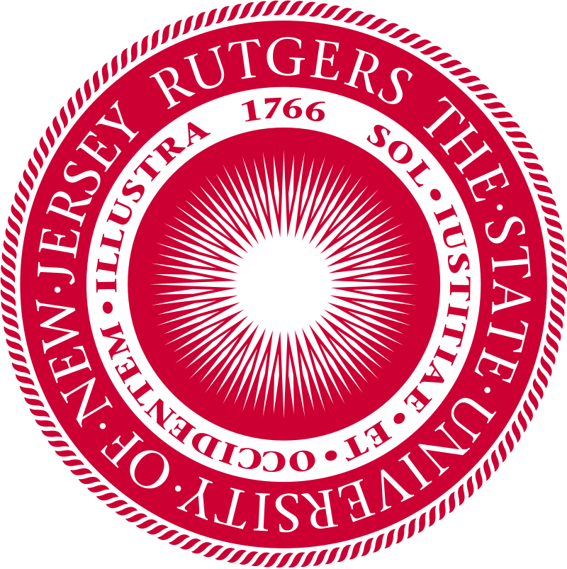
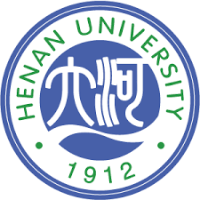
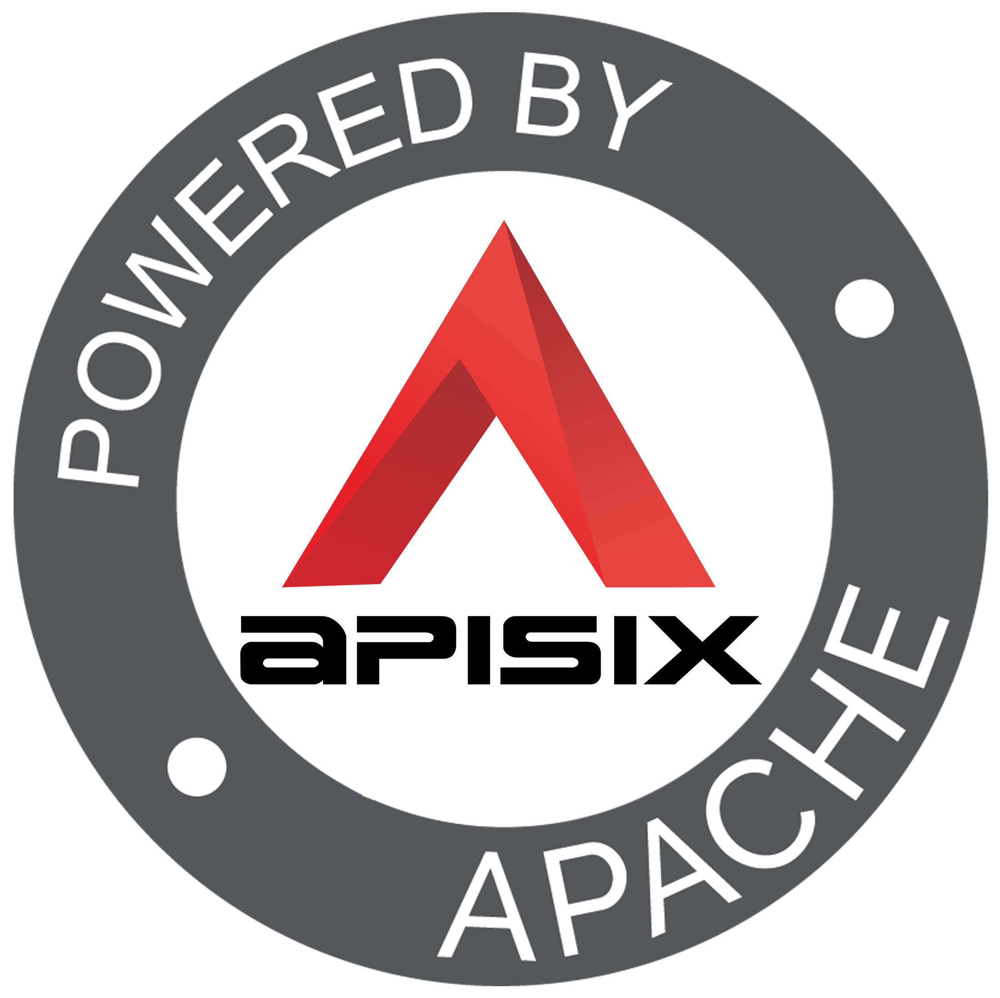

# Biography

## Education

<table class="imgtable"><tbody><tr><td>
  &nbsp; &nbsp; &nbsp;</td>
  <td align="left">
<b>Rutgers University–New Brunswick
  </b>  
  Ph.D., Department of Computer Science
   
  Advisor: <a href="https://people.cs.rutgers.edu/~dnm/">Prof. Dimitris N. Metaxas</a>
   
  New Jersey (USA)
   
  <i>Sep, 2024 -- June, 2029 (Expected)</i>  
  
</td></tr></tbody></table>
 
<table class="imgtable"><tbody><tr><td>
  &nbsp; &nbsp; &nbsp;</td>
  <td align="left">
<b>Victoria University
  </b>  
  B.S., Department of Information Technology
   
  Melbourne (Australia)
   
  <i>Sep, 2020 -- Jun, 2024</i>  
  
</td></tr></tbody></table>
 
<table class="imgtable"><tbody><tr><td>
  &nbsp; &nbsp; &nbsp;</td>
  <td align="left">
<b>Henan University
  </b>  
  B.S., Department of Computer Science and Technology
   
  Zhengzhou (China)
   
  <i>Sep, 2020 -- Jun, 2024</i>
   
  
</td></tr></tbody></table>

## Selected Experience

<!--
<table class="imgtable"><tbody><tr><td>
  &nbsp; &nbsp; &nbsp;</td>
  <td align="left">
<b>Microsoft Research
  </b>  
  Motion Generation Intern, 3DV, Multi-Modal
   
  <i>Summer, 2025 (Expected) -- Winter, 2025</i>  
  
</td></tr></tbody></table>
 
-->
<table class="imgtable"><tbody><tr><td style="width: 120px; padding-right: 10px;">
  </td>
  <td align="left" style="padding-left: 10px;">
<b>Hedra Inc.
  </b>  
  Video-Human Research Intern, GenAI
   
  Mentor: <a href="https://xyyhw.top/">Dr. Hongwei Yi</a>
   
  <i>May, 2025 -- Aug, 2025</i>  
  
</td></tr></tbody></table>
 

<table class="imgtable"><tbody><tr><td>
  &nbsp; &nbsp; &nbsp;</td>
  <td align="left">
<b>University of Central Florida
  </b>  
  3DV-LLM Research Assistant, Multi-Modal
   
  Advisor: <a href="https://www.crcv.ucf.edu/chenchen/">Prof. Chen Chen</a>
   
  <i>Sep, 2023 -- Aug, 2024</i>  
  
</td></tr></tbody></table>
 
<table class="imgtable"><tbody><tr><td>
  &nbsp; &nbsp; &nbsp;</td>
  <td align="left">
<b>University of Texas at Dallas
  </b>  
  Vid2Vid Research Assistant, Multi-Modal
   
  Advisor: <a href="http://www.yapengtian.com/">Prof. Yapeng Tian</a>
   
  <i>Feb, 2023 -- Dec, 2023</i>  
  
</td></tr></tbody></table>
 
<table class="imgtable"><tbody><tr><td>
  &nbsp;&nbsp; &nbsp; &nbsp;</td>
  <td align="left">
<b>Nanyang Technological University
  </b>  
  Speech DL Intern, Multi-Modal
   
  Advisor: <a href="https://github.com/teohteiktoe">Prof. TeikToe Teoh</a>
   
  <i>Jul, 2022 -- Dec, 2022</i>  
  
</td></tr></tbody></table>
 
<table class="imgtable"><tbody><tr><td>
  &nbsp; &nbsp; &nbsp;</td>
  <td align="left">
<b>Apache Software Foundaiton
  </b>  
  Developer Intern, <a href="https://github.com/apache/apisix">APISIX</a>/<a href="https://api7.ai/">api7.ai</a>, <a href="https://news.apache.org/foundation/entry/the-apache-software-foundation-announces66">Top Level Project</a>
   
  Mentor: <a href="https://github.com/SkyeYoung">Tao Yang</a>
   
  <i>Jun, 2022 -- Nov, 2022</i>  
  
</td></tr></tbody></table>
