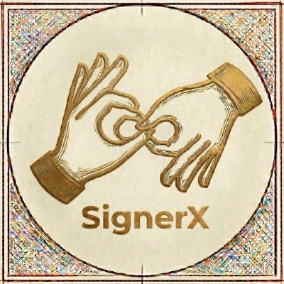

## Community

<!--
- [My Slack Channel](https://join.slack.com/t/senfanglab/shared_invite/zt-3e9y3e85d-jQu5Jt7UDYyEDfkuGCdJWA): I hope to work more closely with contributors or academic developers, perhaps this is necessary.
-->
- [World Snapshot Discord/QQ/WeChat](https://github.com/World-Snapshot/ControlWorld/issues/2): The chat and communication community group of World Snapshot Org, mainly for users.
- [SignerX](https://github.com/SignerX): Create Top-level Sign Language Technology.
- [CS MS/PhD Lab](https://github.com/CSPhDApp): 26-30 Fall PhD Application Discussion Group.
- [HENU-CS](https://github.com/HENU-CS): Organization I initiated: Survival Handbook/Study Abroad Handbook (生存/飞跃手册) of HENU.

## Projects

<link rel="stylesheet" href="static/css/repo.css">

The repositories I have created or led have received <strong data-led-stars>...</strong> stars/upvotes and <strong data-led-forks>...</strong> forks. The projects below that I have contributed to have received <strong data-total-stars>...</strong> stars/upvotes and <strong data-total-forks>...</strong> forks.

  <button class="projects-toggle-btn active" data-view="flat">All</button>
  <button class="projects-toggle-btn" data-view="grouped">By Category</button>

 Indexed by the most relevant attribute of each project.

<h3>World Snapshot Models (WSMs)</h3>

<svg class="repo-card-icon" stroke="currentColor" fill="currentColor" stroke-width="0" viewBox="0 0 12 16" height="14" width="14" xmlns="http://www.w3.org/2000/svg"><path fill-rule="evenodd" d="M4 9H3V8h1v1zm0-3H3v1h1V6zm0-2H3v1h1V4zm0-2H3v1h1V2zm8-1v12c0 .55-.45 1-1 1H6v2l-1.5-1.5L3 16v-2H1c-.55 0-1-.45-1-1V1c0-.55.45-1 1-1h10c.55 0 1 .45 1 1zm-1 10H1v2h2v-1h3v1h5v-2zm0-10H2v9h9V1z"></path></svg> <a href="https://github.com/World-Snapshot/WSMs" class="repo-card-name" target="_blank">World-Snapshot/<strong>WSMs</strong></a> Model System

The official code of World Snapshot Models, including training, inference, evaluation, and data pipelines.

Jupyter Notebook

<svg class="repo-card-icon" stroke="currentColor" fill="currentColor" stroke-width="0" viewBox="0 0 12 16" height="14" width="14" xmlns="http://www.w3.org/2000/svg"><path fill-rule="evenodd" d="M4 9H3V8h1v1zm0-3H3v1h1V6zm0-2H3v1h1V4zm0-2H3v1h1V2zm8-1v12c0 .55-.45 1-1 1H6v2l-1.5-1.5L3 16v-2H1c-.55 0-1-.45-1-1V1c0-.55.45-1 1-1h10c.55 0 1 .45 1 1zm-1 10H1v2h2v-1h3v1h5v-2zm0-10H2v9h9V1z"></path></svg> <a href="https://huggingface.co/World-Snapshot/WSM_v1" class="repo-card-name" target="_blank">World-Snapshot/<strong>WSM_v1</strong></a> Model

The released WSM v1 (Augustus) model weights, task tunnels, and training states.

Model

<svg class="repo-card-icon" stroke="currentColor" fill="currentColor" stroke-width="0" viewBox="0 0 12 16" height="14" width="14" xmlns="http://www.w3.org/2000/svg"><path fill-rule="evenodd" d="M4 9H3V8h1v1zm0-3H3v1h1V6zm0-2H3v1h1V4zm0-2H3v1h1V2zm8-1v12c0 .55-.45 1-1 1H6v2l-1.5-1.5L3 16v-2H1c-.55 0-1-.45-1-1V1c0-.55.45-1 1-1h10c.55 0 1 .45 1 1zm-1 10H1v2h2v-1h3v1h5v-2zm0-10H2v9h9V1z"></path></svg> <a href="https://github.com/World-Snapshot/ControlWorld" class="repo-card-name" target="_blank">World-Snapshot/<strong>ControlWorld</strong></a> WebUI

The reference WebUI for WSM task selection, training, control, and inference.

Python

<svg class="repo-card-icon" stroke="currentColor" fill="currentColor" stroke-width="0" viewBox="0 0 12 16" height="14" width="14" xmlns="http://www.w3.org/2000/svg"><path fill-rule="evenodd" d="M4 9H3V8h1v1zm0-3H3v1h1V6zm0-2H3v1h1V4zm0-2H3v1h1V2zm8-1v12c0 .55-.45 1-1 1H6v2l-1.5-1.5L3 16v-2H1c-.55 0-1-.45-1-1V1c0-.55.45-1 1-1h10c.55 0 1 .45 1 1zm-1 10H1v2h2v-1h3v1h5v-2zm0-10H2v9h9V1z"></path></svg> <a href="https://huggingface.co/spaces/FangSen9000/WSM-ControlWorld" class="repo-card-name" target="_blank">FangSen9000/<strong>WSM-ControlWorld</strong></a> Live Demo

An interactive online demonstration of WSM through the ControlWorld interface.

Hugging Face Space

<svg class="repo-card-icon" stroke="currentColor" fill="currentColor" stroke-width="0" viewBox="0 0 12 16" height="14" width="14" xmlns="http://www.w3.org/2000/svg"><path fill-rule="evenodd" d="M4 9H3V8h1v1zm0-3H3v1h1V6zm0-2H3v1h1V4zm0-2H3v1h1V2zm8-1v12c0 .55-.45 1-1 1H6v2l-1.5-1.5L3 16v-2H1c-.55 0-1-.45-1-1V1c0-.55.45-1 1-1h10c.55 0 1 .45 1 1zm-1 10H1v2h2v-1h3v1h5v-2zm0-10H2v9h9V1z"></path></svg> <a href="https://github.com/World-Snapshot/wsg" class="repo-card-name" target="_blank">World-Snapshot/<strong>wsg</strong></a> Data Format

World Snapshot Graphics (WSG/WSV), the unified world-frame data format and its tools.

Python

<svg class="repo-card-icon" stroke="currentColor" fill="currentColor" stroke-width="0" viewBox="0 0 12 16" height="14" width="14" xmlns="http://www.w3.org/2000/svg"><path fill-rule="evenodd" d="M4 9H3V8h1v1zm0-3H3v1h1V6zm0-2H3v1h1V4zm0-2H3v1h1V2zm8-1v12c0 .55-.45 1-1 1H6v2l-1.5-1.5L3 16v-2H1c-.55 0-1-.45-1-1V1c0-.55.45-1 1-1h10c.55 0 1 .45 1 1zm-1 10H1v2h2v-1h3v1h5v-2zm0-10H2v9h9V1z"></path></svg> <a href="https://world-snapshot.github.io/doc/" class="repo-card-name" target="_blank">World-Snapshot/<strong>Documentation</strong></a> Documentation

Documentation for World Snapshot Models, WSG, pipelines, methods, and tutorials.

HTML

<svg class="repo-card-icon" stroke="currentColor" fill="currentColor" stroke-width="0" viewBox="0 0 12 16" height="14" width="14" xmlns="http://www.w3.org/2000/svg"><path fill-rule="evenodd" d="M4 9H3V8h1v1zm0-3H3v1h1V6zm0-2H3v1h1V4zm0-2H3v1h1V2zm8-1v12c0 .55-.45 1-1 1H6v2l-1.5-1.5L3 16v-2H1c-.55 0-1-.45-1-1V1c0-.55.45-1 1-1h10c.55 0 1 .45 1 1zm-1 10H1v2h2v-1h3v1h5v-2zm0-10H2v9h9V1z"></path></svg> <a href="https://github.com/World-Snapshot/Unified-Law-for-Visual-Tasks" class="repo-card-name" target="_blank">World-Snapshot/<strong>Unified-Law-for-Visual-Tasks</strong></a> Tutorial

The tutorial of Unified Law for Visual Tasks, also known as The Four Laws of Computer Vision.

<h3>Generative Model</h3>

<svg class="repo-card-icon" stroke="currentColor" fill="currentColor" stroke-width="0" viewBox="0 0 12 16" height="14" width="14" xmlns="http://www.w3.org/2000/svg"><path fill-rule="evenodd" d="M4 9H3V8h1v1zm0-3H3v1h1V6zm0-2H3v1h1V4zm0-2H3v1h1V2zm8-1v12c0 .55-.45 1-1 1H6v2l-1.5-1.5L3 16v-2H1c-.55 0-1-.45-1-1V1c0-.55.45-1 1-1h10c.55 0 1 .45 1 1zm-1 10H1v2h2v-1h3v1h5v-2zm0-10H2v9h9V1z"></path></svg> <a href="https://github.com/World-Snapshot/StreamFlow" class="repo-card-name" target="_blank">World-Snapshot/<strong>StreamFlow</strong></a> Framework

[ICML 2026] The Rectified Flow Model can be accelerated by 300% – 600%, and multi-GPU acceleration has no upper limit.

Python

<svg class="repo-card-icon" stroke="currentColor" fill="currentColor" stroke-width="0" viewBox="0 0 12 16" height="14" width="14" xmlns="http://www.w3.org/2000/svg"><path fill-rule="evenodd" d="M4 9H3V8h1v1zm0-3H3v1h1V6zm0-2H3v1h1V4zm0-2H3v1h1V2zm8-1v12c0 .55-.45 1-1 1H6v2l-1.5-1.5L3 16v-2H1c-.55 0-1-.45-1-1V1c0-.55.45-1 1-1h10c.55 0 1 .45 1 1zm-1 10H1v2h2v-1h3v1h5v-2zm0-10H2v9h9V1z"></path></svg> <a href="https://github.com/World-Snapshot/RAC" class="repo-card-name" target="_blank">World-Snapshot/<strong>RAC</strong></a> Framework

Rectified Flow Auto Coder

Python

<h3>Sign Language</h3>

<svg class="repo-card-icon" stroke="currentColor" fill="currentColor" stroke-width="0" viewBox="0 0 12 16" height="14" width="14" xmlns="http://www.w3.org/2000/svg"><path fill-rule="evenodd" d="M4 9H3V8h1v1zm0-3H3v1h1V6zm0-2H3v1h1V4zm0-2H3v1h1V2zm8-1v12c0 .55-.45 1-1 1H6v2l-1.5-1.5L3 16v-2H1c-.55 0-1-.45-1-1V1c0-.55.45-1 1-1h10c.55 0 1 .45 1 1zm-1 10H1v2h2v-1h3v1h5v-2zm0-10H2v9h9V1z"></path></svg> <a href="https://github.com/SignLLM/Prompt2Sign" class="repo-card-name" target="_blank">SignLLM/<strong>Prompt2Sign</strong></a> Dataset

[ICCV 2025 CV4A11y] The Data and Code of Prompt2Sign: A Comprehensive Multilingual Sign Language Dataset.

Python

<svg class="repo-card-icon" stroke="currentColor" fill="currentColor" stroke-width="0" viewBox="0 0 12 16" height="14" width="14" xmlns="http://www.w3.org/2000/svg"><path fill-rule="evenodd" d="M4 9H3V8h1v1zm0-3H3v1h1V6zm0-2H3v1h1V4zm0-2H3v1h1V2zm8-1v12c0 .55-.45 1-1 1H6v2l-1.5-1.5L3 16v-2H1c-.55 0-1-.45-1-1V1c0-.55.45-1 1-1h10c.55 0 1 .45 1 1zm-1 10H1v2h2v-1h3v1h5v-2zm0-10H2v9h9V1z"></path></svg> <a href="https://huggingface.co/datasets/SignerX/SignVerse-2M" class="repo-card-name" target="_blank">SignerX/<strong>SignVerse-2M</strong></a> Dataset

A Two-Million-Clip Pose-Native Universe of 25+ Sign Languages

Dataset

<h3>Software / Dataset</h3>

<svg class="repo-card-icon" stroke="currentColor" fill="currentColor" stroke-width="0" viewBox="0 0 12 16" height="14" width="14" xmlns="http://www.w3.org/2000/svg"><path fill-rule="evenodd" d="M4 9H3V8h1v1zm0-3H3v1h1V6zm0-2H3v1h1V4zm0-2H3v1h1V2zm8-1v12c0 .55-.45 1-1 1H6v2l-1.5-1.5L3 16v-2H1c-.55 0-1-.45-1-1V1c0-.55.45-1 1-1h10c.55 0 1 .45 1 1zm-1 10H1v2h2v-1h3v1h5v-2zm0-10H2v9h9V1z"></path></svg> <a href="https://github.com/apache/apisix" class="repo-card-name" target="_blank">apache/<strong>apisix</strong></a> Framework

The Cloud-Native API Gateway and AI Gateway

Lua

<svg class="repo-card-icon" stroke="currentColor" fill="currentColor" stroke-width="0" viewBox="0 0 12 16" height="14" width="14" xmlns="http://www.w3.org/2000/svg"><path fill-rule="evenodd" d="M4 9H3V8h1v1zm0-3H3v1h1V6zm0-2H3v1h1V4zm0-2H3v1h1V2zm8-1v12c0 .55-.45 1-1 1H6v2l-1.5-1.5L3 16v-2H1c-.55 0-1-.45-1-1V1c0-.55.45-1 1-1h10c.55 0 1 .45 1 1zm-1 10H1v2h2v-1h3v1h5v-2zm0-10H2v9h9V1z"></path></svg> <a href="https://github.com/apache/apisix-dashboard" class="repo-card-name" target="_blank">apache/<strong>apisix-dashboard</strong></a> Framework

Apache APISIX Dashboard

TypeScript

<svg class="repo-card-icon" stroke="currentColor" fill="currentColor" stroke-width="0" viewBox="0 0 12 16" height="14" width="14" xmlns="http://www.w3.org/2000/svg"><path fill-rule="evenodd" d="M4 9H3V8h1v1zm0-3H3v1h1V6zm0-2H3v1h1V4zm0-2H3v1h1V2zm8-1v12c0 .55-.45 1-1 1H6v2l-1.5-1.5L3 16v-2H1c-.55 0-1-.45-1-1V1c0-.55.45-1 1-1h10c.55 0 1 .45 1 1zm-1 10H1v2h2v-1h3v1h5v-2zm0-10H2v9h9V1z"></path></svg> <a href="https://github.com/World-Snapshot/papers-with-code" class="repo-card-name" target="_blank">World-Snapshot/<strong>papers-with-code</strong></a> Website

The first reimplementation of paperswithcode website.

Python

<svg class="repo-card-icon" stroke="currentColor" fill="currentColor" stroke-width="0" viewBox="0 0 12 16" height="14" width="14" xmlns="http://www.w3.org/2000/svg"><path fill-rule="evenodd" d="M4 9H3V8h1v1zm0-3H3v1h1V6zm0-2H3v1h1V4zm0-2H3v1h1V2zm8-1v12c0 .55-.45 1-1 1H6v2l-1.5-1.5L3 16v-2H1c-.55 0-1-.45-1-1V1c0-.55.45-1 1-1h10c.55 0 1 .45 1 1zm-1 10H1v2h2v-1h3v1h5v-2zm0-10H2v9h9V1z"></path></svg> <a href="https://github.com/FangSen9000/ai-tools" class="repo-card-name" target="_blank">FangSen9000/<strong>ai-tools</strong></a> Tool

AI tools collection

<svg class="repo-card-icon" stroke="currentColor" fill="currentColor" stroke-width="0" viewBox="0 0 12 16" height="14" width="14" xmlns="http://www.w3.org/2000/svg"><path fill-rule="evenodd" d="M4 9H3V8h1v1zm0-3H3v1h1V6zm0-2H3v1h1V4zm0-2H3v1h1V2zm8-1v12c0 .55-.45 1-1 1H6v2l-1.5-1.5L3 16v-2H1c-.55 0-1-.45-1-1V1c0-.55.45-1 1-1h10c.55 0 1 .45 1 1zm-1 10H1v2h2v-1h3v1h5v-2zm0-10H2v9h9V1z"></path></svg> <a href="https://github.com/FangSen9000/fast_dwpose" class="repo-card-name" target="_blank">FangSen9000/<strong>fast_dwpose</strong></a> Software

Project repository

<h3>Other</h3>

<svg class="repo-card-icon" stroke="currentColor" fill="currentColor" stroke-width="0" viewBox="0 0 12 16" height="14" width="14" xmlns="http://www.w3.org/2000/svg"><path fill-rule="evenodd" d="M4 9H3V8h1v1zm0-3H3v1h1V6zm0-2H3v1h1V4zm0-2H3v1h1V2zm8-1v12c0 .55-.45 1-1 1H6v2l-1.5-1.5L3 16v-2H1c-.55 0-1-.45-1-1V1c0-.55.45-1 1-1h10c.55 0 1 .45 1 1zm-1 10H1v2h2v-1h3v1h5v-2zm0-10H2v9h9V1z"></path></svg> <a href="https://github.com/FangSen9000/proposal" class="repo-card-name" target="_blank">FangSen9000/<strong>proposal</strong></a> Document

Here are my experiences and proposals for open source activities, such as Google Summer of Code (GSoC) and CAS Open Source Promotion Plan (OSPP)

<svg class="repo-card-icon" stroke="currentColor" fill="currentColor" stroke-width="0" viewBox="0 0 12 16" height="14" width="14" xmlns="http://www.w3.org/2000/svg"><path fill-rule="evenodd" d="M4 9H3V8h1v1zm0-3H3v1h1V6zm0-2H3v1h1V4zm0-2H3v1h1V2zm8-1v12c0 .55-.45 1-1 1H6v2l-1.5-1.5L3 16v-2H1c-.55 0-1-.45-1-1V1c0-.55.45-1 1-1h10c.55 0 1 .45 1 1zm-1 10H1v2h2v-1h3v1h5v-2zm0-10H2v9h9V1z"></path></svg> <a href="https://github.com/HENU-CS/SurvivalHandbook" class="repo-card-name" target="_blank">HENU-CS/<strong>SurvivalHandbook</strong></a> Guide

HENU Survival Handbook / Study Abroad Handbook （河大生存/飞跃手册）

HTML

<svg class="repo-card-icon" stroke="currentColor" fill="currentColor" stroke-width="0" viewBox="0 0 12 16" height="14" width="14" xmlns="http://www.w3.org/2000/svg"><path fill-rule="evenodd" d="M4 9H3V8h1v1zm0-3H3v1h1V6zm0-2H3v1h1V4zm0-2H3v1h1V2zm8-1v12c0 .55-.45 1-1 1H6v2l-1.5-1.5L3 16v-2H1c-.55 0-1-.45-1-1V1c0-.55.45-1 1-1h10c.55 0 1 .45 1 1zm-1 10H1v2h2v-1h3v1h5v-2zm0-10H2v9h9V1z"></path></svg> <a href="https://github.com/FangSen9000/Volcano_Engine_System" class="repo-card-name" target="_blank">FangSen9000/<strong>Volcano_Engine_System</strong></a> Project

Volcano Engine System

<!--

## Other

Part of Friends (random sort)

- Georgia Institute of Technology: [Hongbin Zhong (观鱼)](https://rjzhb.github.io/)
- Columbia University: [Chunyu Sui (林奈)](https://github.com/capsfly)
- Toronto University: [Haris Khan](https://github.com/Wulf)
- Tsinghua University: [Jiayin Zhu](https://www.jiayinzhu.xyz/home)
- University of Waterloo: Yifan Wang
- Nanyang Technological University: [Yalin Feng](https://yalin-feng.github.io)
- Princeton University: [Baiang Li (ztmotalee)](https://ztmotalee.github.io/)
- University of Washington: [Yangyang Wu (考拉)](https://www.linkedin.com/in/yangyang-wu-2759181b3/)

-->
