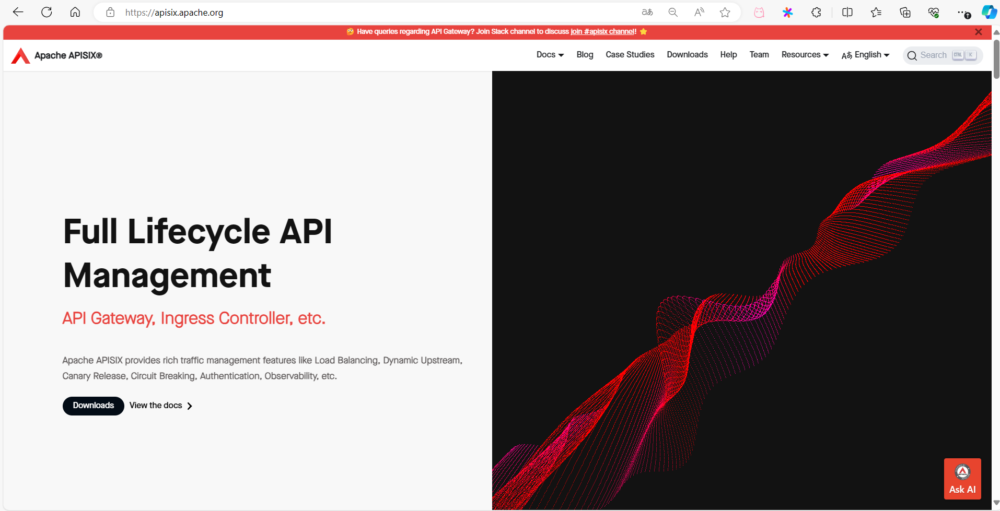
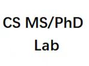
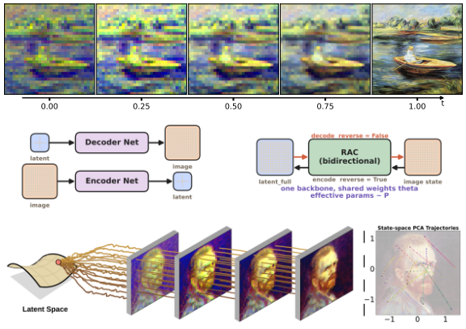
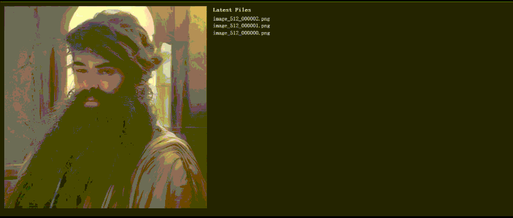
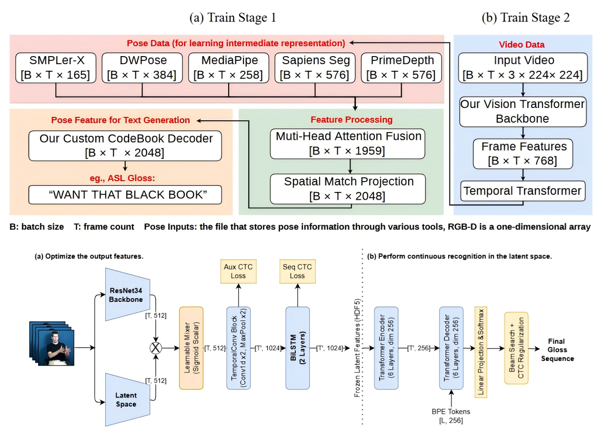
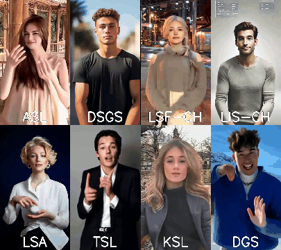
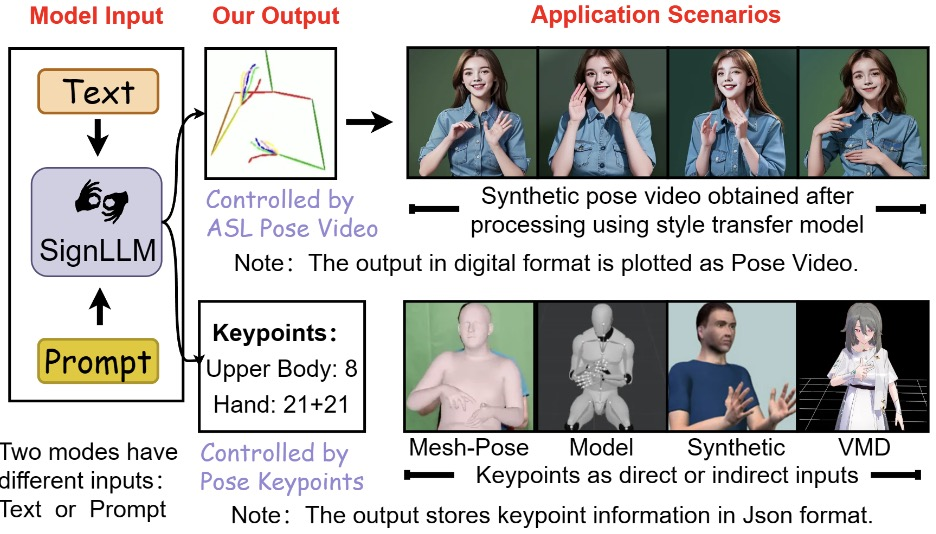
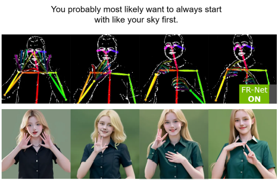

## Community

- [My Slack Channel](https://join.slack.com/t/senfanglab/shared_invite/zt-3e9y3e85d-jQu5Jt7UDYyEDfkuGCdJWA): I hope to work more closely with contributors or academic developers, perhaps this is necessary.
- [World Snapshot Discord/QQ/WeChat](https://github.com/World-Snapshot/ControlWave/issues/2): The chat and communication community group of World Snapshot Org, mainly for users.
- [CS MS/PhD Lab](https://github.com/CSPhDApp): 26-30 Fall PhD Application Discussion Group.
- [HENU-CS](https://github.com/HENU-CS): Organization I initiated: Survival Handbook/Study Abroad Handbook (生存/飞跃手册) of HENU.

## Projects

I maintain these projects: 
- [World Snapshot Org](https://github.com/World-Snapshot)
- Apache Top-Level-Project: [Apache APISIX](https://github.com/apache/apisix) (15k Stars + ) | [Apache APISIX Dashboard](https://github.com/apache/apisix-dashboard)
- Signer-X: [SignDiff](https://signdiff.github.io/) | [SignLLM](https://signllm.github.io/)

*\* Equivalent contribution, † Corresponding author. The following works is based on the most relevant tags, although they overlap with each othero*       
🏆 1~3x SOTA, 💥 over 3~10x improvement / New Concept, 👑 Impacts 100+ Domains / Paradigm Shift, ♾️ Impacts 1000+ Domains / Paradigm Emperoro   

<link rel="stylesheet" href="static/css/pub.css">

e.classList.remove('active'));document.getElementById('pub-featured').classList.add('active');this.parentElement.querySelectorAll('.tab').forEach(e=>e.classList.remove('active'));this.classList.add('active');">Website&#8204;e.classList.remove('active'));document.getElementById('pub-generative').classList.add('active');this.parentElement.querySelectorAll('.tab').forEach(e=>e.classList.remove('active'));this.classList.add('active');">Repo&#8204;e.classList.remove('active'));document.getElementById('pub-sign').classList.add('active');this.parentElement.querySelectorAll('.tab').forEach(e=>e.classList.remove('active'));this.classList.add('active');">Patent

<table class="imgtable"><tbody><tr><td>
  &nbsp; &nbsp; &nbsp;</td>
  <td align="left">
<b> Apache APISIX: Full Lifecycle API Management, API Gateway, Ingress Controller, etc.
  </b>  
  Maintainer, <a href="https://news.apache.org/foundation/entry/the-apache-software-foundation-announces66">Top Level Project</a>
   
  [<a href="https://apisix-dashboard.apiseven.com/">APISIX Dashboard Demo</a>]  [<a href="https://github.com/apache/apisix">APISIX Github</a>]  [<a href="https://github.com/apache/apisix-dashboard">APISIX Dashboard Github</a>]
  
</td></tr></tbody></table>

<table class="imgtable"><tbody><tr><td>
  &nbsp; &nbsp; &nbsp;</td>
  <td align="left">
<b>24-25Fall PhD Application Group
  </b>  
  Owener, QQ group ID: 231622772
   
  <i>As its name suggests, it is a QQ group of over 700 PhD applicants.</i>  
  
</td></tr></tbody></table>

*According to my Unified Laws, all visual tasks only require generative methods. Therefore, GenAI will be the focus of 90% of visual professionals.*

**RAC: Rectified Flow Auto Coder**     
**Sen Fang**, Yalin Feng*, Yanxin Zhang, Dimitris N. Metaxas†      
[[Paper]](https://arxiv.org/abs/2511.22009) [[Project Page]](https://world-snapshot.github.io/RAC) [[Code]](https://github.com/World-Snapshot/RAC)          
💥 **Concept breakthrough:** Make the reconstruction task a condition generation task; Make the decoder the encoder; Make the single-step decoding and encoding a multi-step decoding and encoding.

**StreamFlow: Theory, Algorithm, and Implementation for High-Efficiency Rectified Flow Generation**     
**Sen Fang**, Hongbin Zhong*, Yalin Feng, Dimitris N. Metaxas†      
[[Paper]](https://arxiv.org/abs/2511.22009) [[Project Page]](https://world-snapshot.github.io/StreamFlow/) [[Code]](https://github.com/World-Snapshot/StreamFlow)          
💥 **Order-of-magnitude performance breakthrough:** The generation speed of Rectified Flow has been accelerated up to 611%, while the universal training-free Flow acceleration methods during the same period only increased by 18% or 30%.

**SignX: Continuous Sign Recognition in Compact Pose-Rich Latent Space**    
**Sen Fang**, Yalin Feng*, Chunyu Sui, Hongbin Zhong, Hongwei Yi, Dimitris N. Metaxas†      
[[Paper]](https://arxiv.org/abs/2504.16315) [[Project Page]](https://signerx.github.io/SignX/)      
🏆 **Performance breakthrough:**  2026 CSLR SOTA. The recognition and understanding tasks on any sign language dataset can/will achieve state-of-the-art results.

**Stable Signer: Hierarchical Sign Language Generative Model**      
**Sen Fang**, Yalin Feng*, Hongbin Zhong, Yanxin Zhang, Dimitris N. Metaxas†        
*ICCV 2025 Demo Track*       
[[Paper]](https://arxiv.org/abs/2512.04048) [[Project Page]](https://stablesigner.github.io/) [[Data]](https://github.com/SignLLM/Prompt2Sign/tree/main/tools-new-2025)     
🏆 **Significant performance breakthrough:** Outperforms contemporary state-of-the-art generation methods by 48.6%.

**SignLLM: Sign Language Production Large Language Models**     
**Sen Fang**, Chen Chen†, Lei Wang, Ce Zheng, Chunyu Sui, Yapeng Tian       
*ICCVW 2025*        
[[Paper]](https://arxiv.org/abs/2405.10718) [[Project Page]](https://signllm.github.io/) [[Data]](https://signllm.github.io/Prompt2Sign)      
💥 **Order-of-magnitude width breakthrough:** The single model supports the generation of 8 types of sign languages, and the number of SLP tasks it supports has increased by eight times.

<!--

**SignDiff: Diffusion Models for American Sign Language Production**
**Sen Fang**, Chunyu Sui\*, Yanghao Zhou, Xuedong Zhang, Hongbin Zhong, Yapeng Tian†, Chen Chen†
*IEEE FG 2025 Workshop*
[[Paper]](https://arxiv.org/abs/2308.16082) [[Project Page]](https://signdiff.github.io) [[Preprocessed Data]](https://github.com/SignDiff/Processed-Data)

-->

<!--

## Other

Part of Friends (random sort)

- Georgia Institute of Technology: [Hongbin Zhong (观鱼)](https://rjzhb.github.io/)
- Columbia University: [Chunyu Sui (林奈)](https://github.com/capsfly)
- Toronto University: [Haris Khan](https://github.com/Wulf)
- Tsinghua University: [Jiayin Zhu](https://www.jiayinzhu.xyz/home)
- University of Waterloo: Yifan Wang
- Nanyang Technological University: [Yalin Feng](https://yalin-feng.github.io)
- Princeton University: [Baiang Li (ztmotalee)](https://ztmotalee.github.io/)
- University of Washington: [Yangyang Wu (考拉)](https://www.linkedin.com/in/yangyang-wu-2759181b3/)

-->